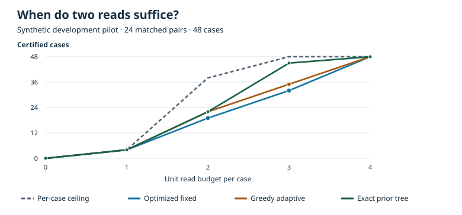

# ResumeCert

**Budgeted evidence for resuming agent workflows after external state changes.**

[فارسی](README.fa.md) · [Research proposal PDF](docs/proposal/ResumeCert_Research_Proposal_FA.pdf) · [Editable proposal](docs/proposal/ResumeCert_Research_Proposal_FA.docx) · [Academic acknowledgments](docs/ACKNOWLEDGMENTS.md)

An agent can remember the correct next step after an interruption even when that step is no longer allowed. ResumeCert asks which current facts an agent should reread, within a fixed budget, to certify that step as permitted or blocked. If both outcomes remain possible, it defers.

For example, a document may have a recorded approval but a newer version than the one approved. The proposed benchmark holds the action, checkpoint, and resumption message constant across matched scenarios and changes the precondition that governs the action. An independent verifier checks the decision, supporting observations, and read cost.

## Research status

| Item | Status |
|---|---|
| [Formal proposal](docs/proposal/ResumeCert_Research_Proposal_FA.pdf) | Available |
| [Research protocol](docs/research/RESEARCH_PROTOCOL_FA.md) and [primary source matrix](docs/research/EVIDENCE_MATRIX_FA.md) | Available; the formal proposal governs the planned design if details differ |
| [Exhaustive eight-state witness](proof/witness.py) | Reproducible |
| [Simulator and independent verifier](docs/research/SIMULATOR_V1.md) | Available; [64 witness runs and decision fixtures](results/simulator_smoke_v1.json) reproduced |
| [Matched development pilot](docs/research/MATCHED_PILOT_V1.md) | Available; 24 pairs, three synthetic families, and 12 controls |
| [Confirmatory protocol and freeze](docs/research/CONFIRMATORY_PROTOCOL_V1.md) | Recorded before evaluation; 48 pairs in two new families |
| [Held-out confirmatory comparison](docs/research/CONFIRMATORY_RESULTS_V1.md) | Complete; 11/96 for each method at two reads |

The witness uses three Boolean fields and eight constructed states. With two unit-cost reads, the best fixed field set certifies **4 of 8** states; an adaptive tree that reads the active route and then the corresponding approval certifies **8 of 8**. This is an exact result for the constructed example. No LLM or real workflow was evaluated.

## Development pilot

At two unit reads per case, greedy adaptive reads certify **22/48** cases versus **19/48** for an optimized fixed order at the same total cost. With a cheap grouped read, both reach **32/48**. The [pilot report](docs/research/MATCHED_PILOT_V1.md) separates the gains, the cost of observations, and the cases where evidence is insufficient.



## Confirmatory result

At two unit-cost reads, greedy adaptive and optimized fixed certified the same **11/96** snapshots in the two held-out families. Each spent 184 units. The registered interpretation is **no pooled gain**. Adding a unit-cost grouped query raised both to **30/96** at the same total cost. See the [report](docs/research/CONFIRMATORY_RESULTS_V1.md) and [full run traces](results/confirmatory_v1_runs.jsonl.gz).

## Exploratory SQLite transfer

An archive receipt experiment checks whether a verified snapshot certificate still authorizes the action after another writer changes the database. At budget four, atomic sufficient-evidence revalidation wrote **64 valid and zero invalid receipts**, compared with **60 valid and zero invalid** for matching all evidence. Full predicate evaluation wrote **76 valid and zero invalid**. [Study and complete traces](docs/research/ARCHIVE_TRANSFER_V1.md)

## Reproduce

Python 3.12 is used for repository verification. No API key, GPU, or package installation is needed.

```bash
python proof/witness.py
python scripts/verify_repository.py
python -m unittest discover -s tests -v
python -m resumecert demo --check results/simulator_smoke_v1.json
python -m resumecert pilot --check results/matched_pilot_v1.json
python scripts/verify_freeze.py
python scripts/run_confirmatory.py --check results
python scripts/run_archive_transfer.py --check results
```

GitHub Actions runs the reproduction and unit checks. The artifact check preserves the recorded witness and the proposal and institutional mark digests; the simulator checks cover the read budget and evidence verification.

## Next milestone

The SQLite transfer is complete. A model-based read policy remains a potential exploratory study. See the [research status and roadmap](docs/research/STATUS.md).

To cite this repository, use [CITATION.cff](CITATION.cff). The institutional marks are displayed in the [acknowledgments](docs/ACKNOWLEDGMENTS.md) for educational context.
