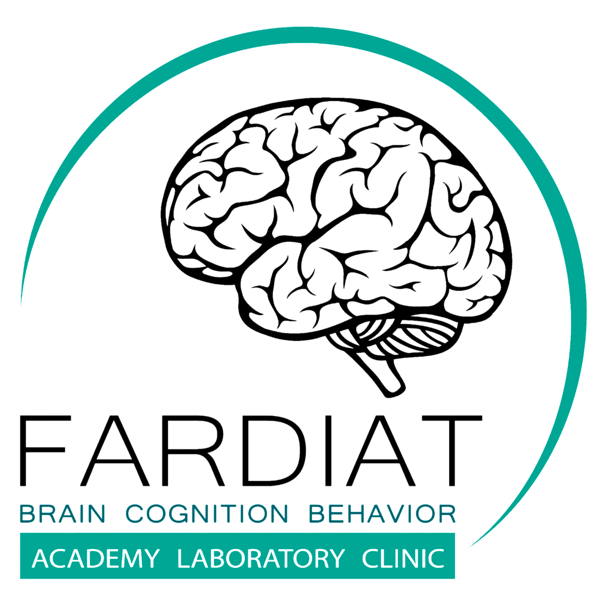
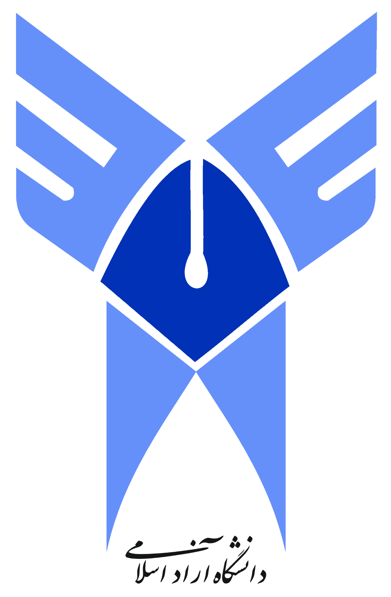

# قدردانی علمی

پژوهشگر، **یوسف ابوالفتحی روزبهانی**، از استادان زیر برای بررسی علمی و تایید موضوع و پروپوزال اولیه‌ی پژوهش ResumeCert قدردانی می‌کند. این تاییدها بر اساس گزارش پژوهشگر ثبت شده‌اند.

| استاد | زمینه‌ی آشنایی و بازبینی |
| --- | --- |
| **دکتر آرش فکری** | استاد پژوهشگر در حوزه‌ی مغز و شناخت و، به معرفی پژوهشگر، مدیر و بنیان‌گذار مجموعه‌ی فردیت. [پروفایل لینکدین](https://ir.linkedin.com/in/dr-arash-fekri) · [صفحه‌ی فردیت](https://ir.linkedin.com/company/fardiat) |
| **دکتر دانیال رحیمی‌زاده** | استاد درس سیگنال و سیستم پژوهشگر در دانشگاه آزاد اسلامی، واحد کرج. |

نشان‌های زیر برای معرفی زمینه‌ی آموزشی و قدردانی نمایش داده شده‌اند. بازبینی استادان به‌عنوان مشارکت نویسندگی، حمایت مالی یا تایید رسمی سازمانی ثبت نشده است.

<table>
<tr>
<td align="center"> فردیت</td>
<td align="center"> دانشگاه آزاد اسلامی</td>
</tr>
</table>

## Academic acknowledgment

According to the researcher, **Dr. Arash Fekri**, his brain and cognition instructor and the director and founder of Fardiat as identified by the researcher, and **Dr. Danial Rahimizadeh**, his Signals and Systems instructor at Islamic Azad University, Karaj Branch, reviewed and approved the research topic and initial proposal. These are individual academic reviews. The marks identify the educational context.
