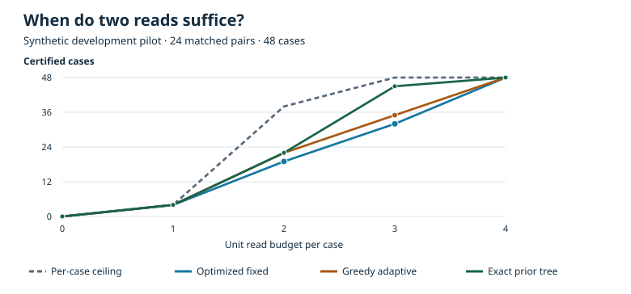

# ResumeCert · Matched development pilot

[فارسی](MATCHED_PILOT_V1_FA.md) · [Evidence update](FRONTIER_2026_11.md) · [Fixtures](../../results/matched_pilot_fixtures_v1.json) · [Results](../../results/matched_pilot_v1.json)

## Question and design

Does choosing the next read after seeing an earlier answer increase the fraction of decisions a verifier can certify at the same read budget? The question concerns a fixed next action and a stable snapshot after interruption.

Each of three synthetic families contributes eight pairs: **report release** (route and version-specific approval), **dispatch** (two eligible routes), and **register** (prior completion and receipt). Each pair shares the contract, earlier state, checkpoint, resumption message, query prices, and empty initial current facts. One member changes a pivotal field and flips the decision. The other changes an irrelevant field and retains the decision. In both members exactly one binary field or two-valued version changes. Within each family, two pairs occupy each combination of prior action truth and low/high shift in the resumption message. This controls label leakage through the text; it does not measure a language model or isolate an effect of topic shift. Opaque scope IDs are independent of the current values and the policies ignore them.

The fixture generator selects diverse pivotal fields and distinct intervention edges without using policy scores. The policy receives only the public context and read callable. Policy order planning never sees the recipe list, the actual state, or observed pilot frequencies. This is an in-process research harness for trusted Python policies. Pair matching, zero-read behavior, budgets, and final claims are checked during evaluation. The pilot is developmental and was not preregistered.

The primary grid uses **48 cases × five unit-read budgets × six policies = 1,440 runs**. Separately: 12 controls (six unchanged after interruption and six uninterrupted with trusted current facts) at two budgets, a grouped-read sensitivity at budget two, and a full-read reference. Total: **1,776 runs**. These are repeated evaluations of synthetic cases, not independent samples.

## Policies and diagnostics

| Method | Information and decision rule |
| --- | --- |
| Checkpoint replay | Claims the recorded past decision at no cost; the verifier independently rejects unsupported claims. |
| Always defer | Claims uncertainty with no reads. The verifier accepts this only when the evidence leaves both decisions possible. |
| Seeded random order | Samples one fixed order per public context. The pair shares the seed. Stops on a certificate or budget. |
| Optimized fixed order | Exhaustively selects a single order per contract and budget using a uniform prior over admissible worlds consistent with initial facts. |
| Greedy adaptive | Chooses each next affordable query by expected decrease in decision impurity per cost. |
| Exact prior tree | Dynamic programming optimizes expected coverage over the same uniform prior and query catalog. Both exact planners break coverage ties by lower expected cost, then catalog order. |
| Full read | Reads every primary field and is reported outside the equal-budget comparison. |

The exact tree is optimal for its declared prior and budget; its observed coverage on the development fixtures is not an empirical upper bound for all policies. The per-case hindsight ceiling is different: it counts cases with at least one affordable certifying subset chosen with the actual world already known. It is not a runnable policy. Raw false decisions are counted before audit. Certified decisions require the audit to accept a definitive and correct claim.

## Observed results



| Budget per case | Random | Optimized fixed | Greedy adaptive | Exact prior tree | Per-case hindsight |
| ---: | ---: | ---: | ---: | ---: | ---: |
| 0 | 0/48 | 0/48 | 0/48 | 0/48 | 0/48 |
| 1 | 3/48 | 4/48 | 4/48 | 4/48 | 4/48 |
| 2 | 8/48 | 19/48 | 22/48 | 22/48 | 38/48 |
| 3 | 15/48 | 32/48 | 35/48 | 45/48 | 48/48 |
| 4 | 29/48 | 48/48 | 48/48 | 48/48 | 48/48 |

At budget two, fixed and greedy adaptive each spend 92 read units across 48 cases. The exact tree reaches the same coverage as greedy with 82 units. Both arms are certified in **5/24 pairs** for optimized fixed and **7/24** for each adaptive method. All three extra greedy certificates occur in dispatch (4/16 fixed, 7/16 greedy). Release is 6/16 for both; register is 9/16 for both. No wrong definitive claim from a read-based policy was verified.

At the same budget, **10 cases** lack any affordable per-case certificate. Of the remaining 38, the exact prior tree leaves 16 uncertified. Some may require incompatible query choices, so the 16 cannot be called avoidable errors. At budget three, the greedy policy certifies 35 and the exact tree 45; the greedy heuristic does not capture all the available planning benefit.

With a new unit-cost query that returns two specified fields, fixed and greedy both reach **32/48** at 88 units; the exact tree reaches **46/48** at 92 units. This sensitivity changes the price of obtaining jointly relevant information and can erase the greedy advantage. It does not erase the exact tree's advantage in these fixtures. Checkpoint replay made 12 false allows among 24 truly blocked cases and 12 false blocks among 24 truly allowed cases. All 48 replay claims were rejected for lack of a sufficient current proof, including correct guesses. Full read certified 48/48 with 224 units. The independent controls confirm that an unchanged world can remain ambiguous after interruption, while complete trusted current facts certify all six uninterrupted controls with zero reads.

## Reproduce

Run from the repository root with Python 3.12. No packages, API, model, or GPU are required.

```bash
python -m resumecert pilot --check results/matched_pilot_v1.json
python -m resumecert pilot --format fixtures --check results/matched_pilot_fixtures_v1.json
python -m resumecert pilot --format svg --check results/matched_pilot_coverage_v1.svg
python -m resumecert pilot --format runs > pilot_runs.json
```

The summary contains SHA-256 digests of the canonical fixture and full run JSON (sorted keys and compact separators). Per-run output includes the query and observation trace, cost, truth, and verifier outcome. The next stage freezes the primary contrast, budget grid, outcome measures, two unused families, and exclusion rules before the confirmatory evaluation. The 24 development pairs must not enter the held-out set.
