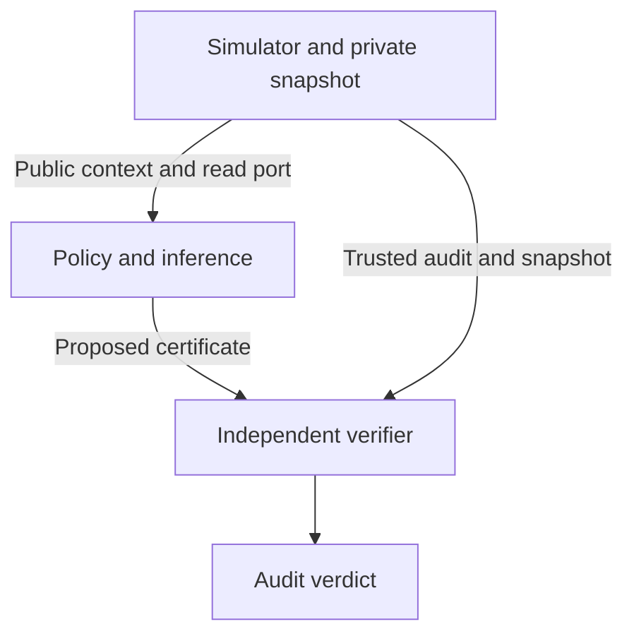

# Simulator v1: action contracts, budgeted reads, and audit

[فارسی](SIMULATOR_V1_FA.md) · [Roadmap](STATUS.md) · [Recorded fixture output](../../results/simulator_smoke_v1.json)

## The question this milestone makes testable

A policy is told which action it would resume. It must determine whether the available current evidence certifies that action within an assigned budget. The environment is a fixed snapshot after the interruption. An old checkpoint and a resumption message can guide which query to ask, but contribute no current facts.

For an action contract with an admissible set of worlds Ω and a Boolean precondition, retain the worlds consistent with the declared initial current facts and observations. The decision is:

| Compatible worlds | Decision |
| --- | --- |
| Nonempty; the precondition holds in every world | `allow` |
| Nonempty; the precondition fails in every world | `block` |
| Both outcomes remain possible | `defer` |
| No compatible world | `inconsistent` |

These labels are relative to the contract and declared observations. An accepted `defer` means the uncertainty was correctly reported. The simulator never executes the action.

## Interfaces and trust



| Component | Reads | Produces |
| --- | --- | --- |
| [Action contract](../../resumecert/contract.py) | Declared finite domains, admissibility, precondition, queries, costs | Canonical digest and enumerable candidate worlds |
| [Simulator](../../resumecert/simulator.py) | The contract and a private snapshot validated against it | Public context, a scoped read callable, and a separate trusted audit ledger |
| [Policy and inference](../../resumecert/inference.py) | Public context and paid observations | Decision, evidence, compatible world count, and spent budget |
| [Verifier](../../resumecert/verifier.py) | Trusted audit and the submitted certificate | Acceptance or a rejection reason |

Contracts declare immutable scalar domains and use `eq`, `all`, `any`, and `not` expressions. An equality operand is a field or a literal. The language distinguishes Booleans from integers. The initial implementation caps the Cartesian product at 256 states before applying any admissibility constraint. A query may return multiple declared fields and costs a positive integer. Repeating a successful query incurs its full cost. Undeclared queries and reads beyond budget are rejected without recording an observation or charging budget.

A certificate binds to the action, the contract digest, the snapshot identifier, and the run identifier. The harness must assign opaque IDs independently of snapshot values and a fresh run ID to each run. It must not encode the answer, the fixture's condition, or a digest of the private state in public fields. An authenticated audit source is assumed; the certificate carries evidence but has no cryptographic signature.

The verifier checks the complete ordered transcript, answer authenticity, costs, and scope. It independently recomputes the number and disposition of compatible worlds. It uses the private snapshot to check the provenance of readings and the initial current facts; unobserved private fields are excluded from the sufficiency calculation. The verifier shares the contract evaluator with the simulator and does not call the policy or certificate producer. For pilot policies, provide only the public context and query interface; this Python interface assumes trusted in-process code. It is not a sandbox. Snapshot changes during a run and during execution are outside this design.

## Reproduce the exit gate

Use Python 3.12. The checks need no dependencies, credentials, GPU, or external data.

```bash
python scripts/verify_repository.py
python -m unittest discover -s tests -v
python -m resumecert demo --check results/simulator_smoke_v1.json
```

The two policies were run on each of eight worlds at each of four budgets. The independent verifier accepted all 64 resulting certificates, including correct deferrals. The coverage counts match the [separately computed witness](../../proof/witness_result.json).

| Unit read budget per run | Fixed: certified of 8 | Adaptive: certified of 8 | Fixed total cost | Adaptive total cost |
| ---: | ---: | ---: | ---: | ---: |
| 0 | 0 | 0 | 0 | 0 |
| 1 | 0 | 0 | 8 | 8 |
| 2 | 4 | 8 | 16 | 16 |
| 3 | 8 | 8 | 20 | 16 |

The version fixture allows an approved version, blocks a later version with stale approval, and defers when there is budget to see only one of the two values. In an injected contradiction, the inference layer reports zero compatible worlds; the verifier rejects the contradictory transcript against the trusted ledger and rejects a ledger whose observation disagrees with its snapshot. A stable authentic snapshot cannot produce that contradiction.

These are deterministic engineering checks. The [development pilot](MATCHED_PILOT_V1.md) is reported separately, with matching and leakage audits, independent controls, and verified baseline budgets. The simulator outputs do not establish a general benefit of adaptivity.
